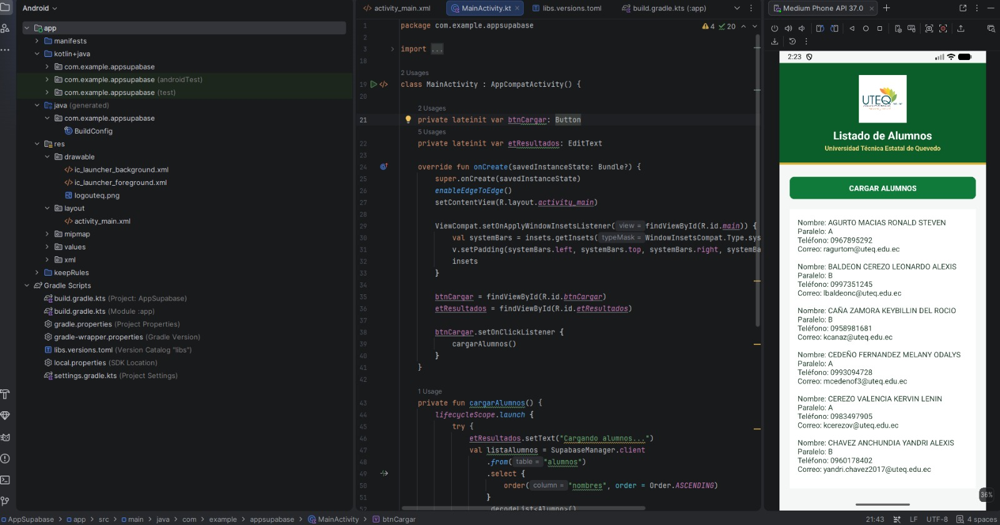
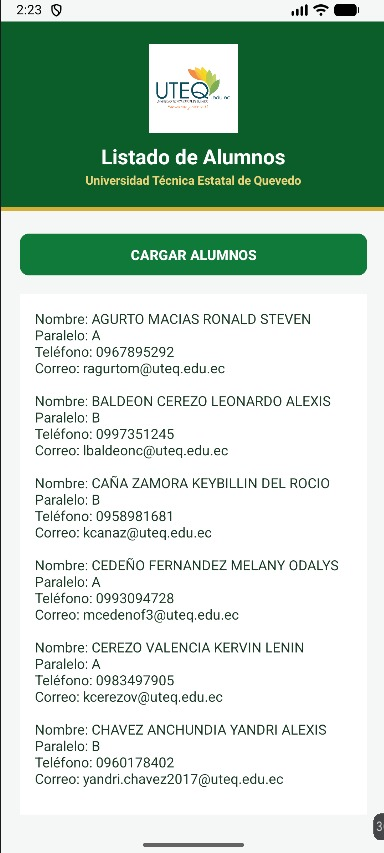

# 📱 AppSupabase - Gestión de Alumnos (UTEQ)

Aplicación móvil nativa desarrollada en **Android Studio** utilizando **Kotlin** y **XML**, conectada en tiempo real a una base de datos en la nube con **Supabase** (PostgreSQL). Este proyecto fue realizado como actividad práctica académica para la **Universidad Técnica Estatal de Quevedo (UTEQ)**.

## 🎯 Descripción de la Actividad
El objetivo de la aplicación es consumir los registros de la tabla `alumnos` alojada en Supabase y mostrarlos en una interfaz personalizada con la identidad institucional de la UTEQ. 

Entre las funcionalidades implementadas destacan:
* **Conexión segura a Supabase:** Configuración mediante credenciales locales (`local.properties`) protegidas fuera del control de versiones.
* **Consulta y ordenamiento alfabético:** Recuperación de datos ordenada de forma ascendente (`Order.ASCENDING`) por el campo `nombres` (de la A a la Z).
* **Visualización estructurada:** Presentación clara de los datos de cada estudiante:
  * **Nombre**
  * **Paralelo**
  * **Teléfono**
  * **Correo electrónico**
* **Manejo de errores:** Control de excepciones de red y respuestas vacías mediante notificaciones (`Toast`) y mensajes en pantalla.

## 🛠️ Tecnologías Utilizadas
* **Lenguaje:** Kotlin
* **Interfaz de Usuario:** XML / Material Design
* **Base de Datos / Backend:** Supabase (PostgREST)
* **Asincronía:** Kotlin Coroutines (`lifecycleScope`)

## 📸 Capturas de la Aplicación

| Pantalla Principal / Carga | Lista Ordenada Alfabéticamente (A-Z) |
| :---: | :---: |
|  |  |

---
**Desarrollado por:** [Elkyn Saul Mora Guerra](https://github.com/RakYn7) — Universidad Técnica Estatal de Quevedo (UTEQ)
